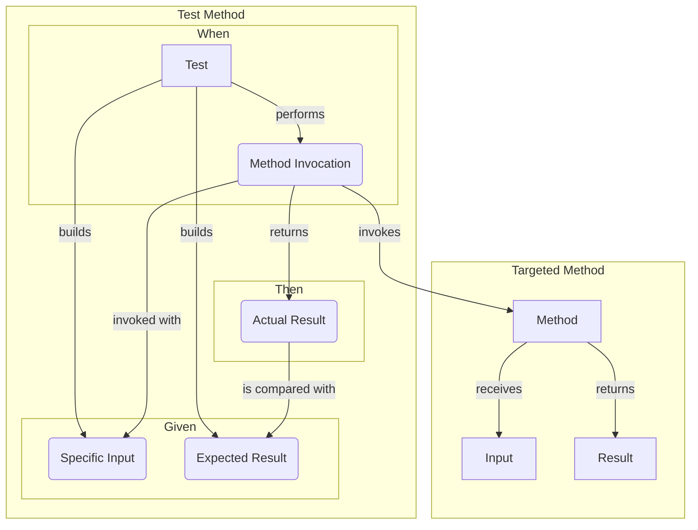
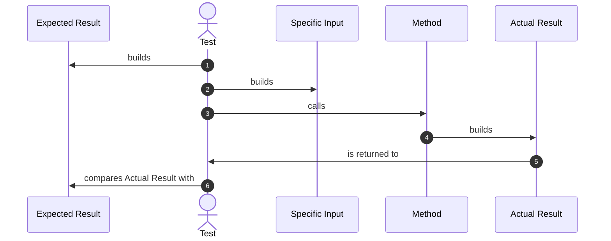
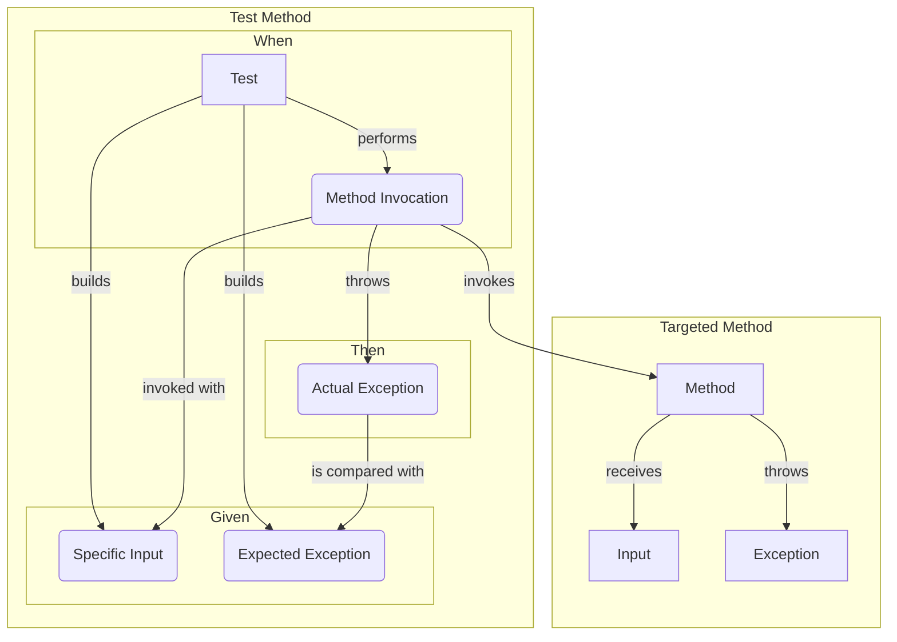
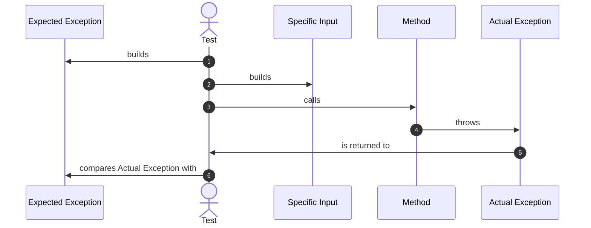
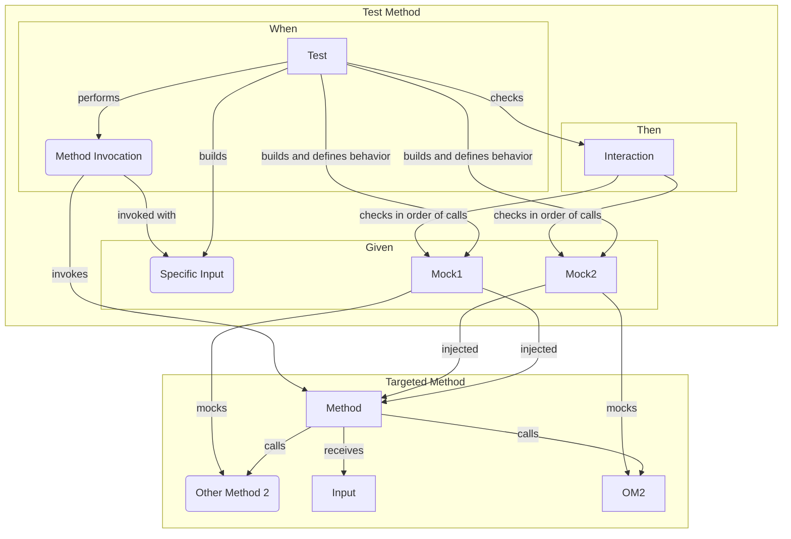
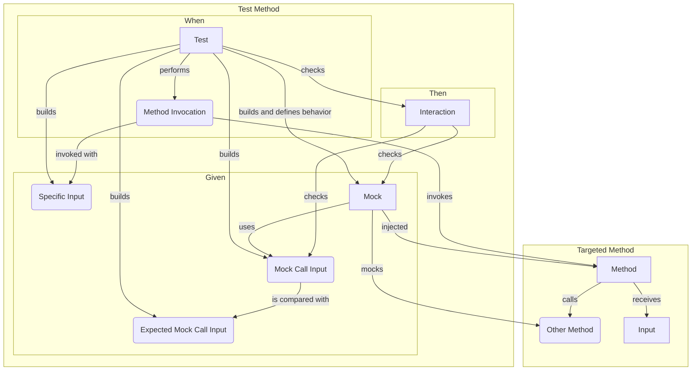

Simple test (Input vs Output)

---
Simple test (Input vs Output) sequence

---
Simple test (Input vs Exception)

---
Simple test (Input vs Exception) sequence

---
Simple test (Mock interaction)

---
Simple test (Mock interaction with dynamic input)
